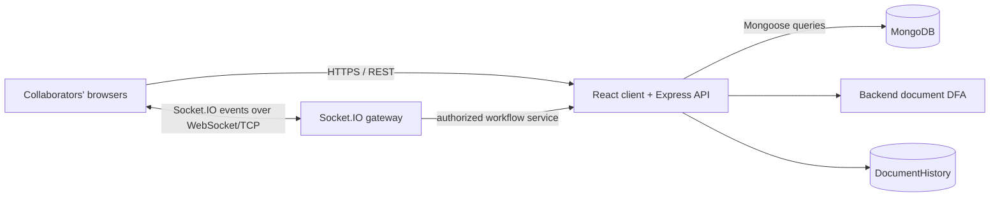

# System architecture

## Client-server and persistence flow



The React application is an untrusted client. Express authenticates requests, checks document membership and lock ownership, and invokes the backend DFA before persisting a state change. MongoDB is the source of truth for saved content and durable state. Socket.IO distributes authorized changes and presence to collaborators in a document room; it does not replace database persistence.

## Planned backend MVC structure

```text
backend/
  automata/       reusable transition function and validation
  config/         MongoDB and environment setup
  controllers/    HTTP request handling
  middleware/     JWT auth, validation, error handling
  models/         User, Document, DocumentHistory
  routes/         versioned REST endpoints
  services/       authorization, document workflow and persistence
  sockets/        authenticated room event handlers
  utils/          regular expressions and shared helpers
```

## Application state lifecycle

The backend DFA has the states Idle, Editing, Saving, Saved and Locked. Only declared events can change the state. A save moves Editing → Saving; only a successful database operation permits Saving → Saved. A persistence error returns Saving → Editing. A lock is authorized by the workflow layer and transitions Editing/Saved → Locked. Only its owner (or the defined disconnect cleanup) may unlock it. The transition table is implemented in `backend/automata/documentDfa.js`.
