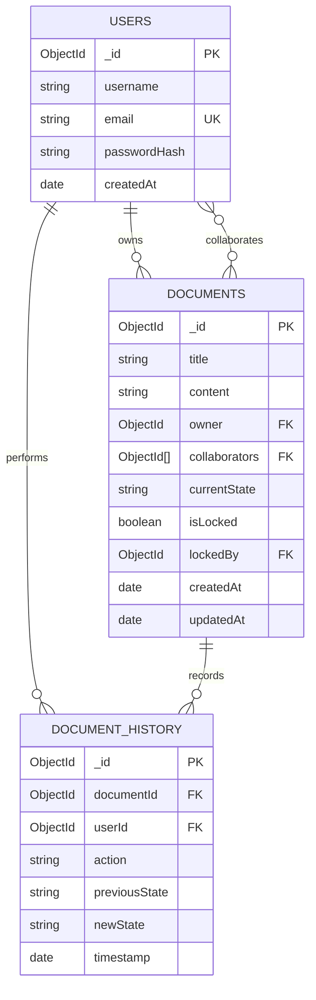

# Database design

MongoDB stores three Mongoose collections. Relationships use ObjectIds and references.

| Collection | Fields and relationships |
|---|---|
| Users | `username`, unique lowercase `email`, `passwordHash` (excluded from normal queries), `createdAt` |
| Documents | `title`, `content`, `owner → Users`, `collaborators → Users[]`, `currentState`, `isLocked`, `lockedBy → Users`, `createdAt`, `updatedAt` |
| DocumentHistory | `documentId → Documents`, `userId → Users`, `action`, `previousState`, `newState`, `timestamp` |

Schemas are in `backend/models/`. Mongoose validates required fields, enum state, uniqueness, length bounds and email/username forms. Passwords are bcrypt hashes; the API never returns the hash. Deleting a document also removes its history.
