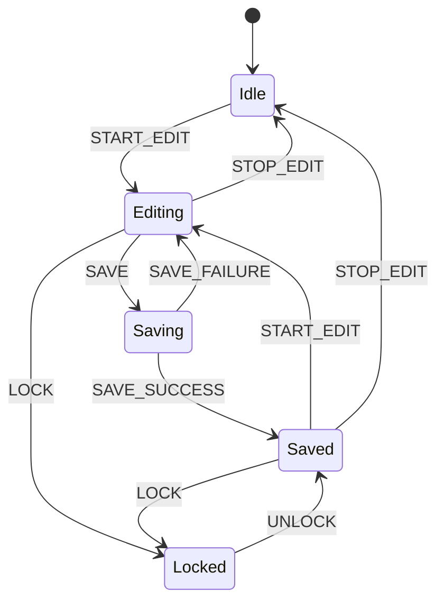

# Formal Languages and Automata Theory integration

## DFA definition

The document workflow is a deterministic finite automaton (M=(Q,Σ,δ,q₀,F)). Here (Q={Idle, Editing, Saving, Saved, Locked}), the event alphabet is (Σ={START_EDIT,SAVE,SAVE_SUCCESS,SAVE_FAILURE,LOCK,UNLOCK,STOP_EDIT}), and the transition function is the table below. The implementation tracks one current state and accepts an event only when the transition function defines a destination. “Accepted” means the transition is defined; it does not mean that the document is globally final. `Saved` is the successful persistence state.

| Current state | Input | Next state |
|---|---|---|
| Idle | START_EDIT | Editing |
| Editing | SAVE | Saving |
| Saving | SAVE_SUCCESS | Saved |
| Saving | SAVE_FAILURE | Editing |
| Saved | START_EDIT | Editing |
| Editing | LOCK | Locked |
| Saved | LOCK | Locked |
| Locked | UNLOCK | Saved |
| Editing | STOP_EDIT | Idle |
| Saved | STOP_EDIT | Idle |

All unlisted state/input pairs are rejected. The `Locked` state has only `UNLOCK`, so editing and saving cannot proceed until the owner releases the lock. The socket disconnect handler uses this same `UNLOCK` transition when the lock owner disconnects.

## Transition diagram

## Implementation and enforcement

- `backend/automata/documentDfa.js` defines states, alphabet, transition function, current state, accepted inputs, accepted/rejected transition history and `InvalidTransitionError`.
- `backend/services/documentService.js` reconstructs the automaton from the persisted state before saving content or changing lock state. An invalid event is not accepted as a state change.
- `backend/controllers/automataController.js` powers the DFA page through the same backend class. Its isolated learning trace does not mutate a stored document.
- `backend/automata/documentDfa.test.js` contains executable Node test cases for valid and invalid transitions.

The DFA page describes its isolated trace honestly. Real editor actions use the same transition logic on the persisted document state, and state changes are broadcast to its Socket.IO room.

## Regular expressions

`backend/utils/validators.js` exports patterns and predicates. Email is checked with `/^[^\s@]+@[^\s@]+\.[A-Za-z]{2,}$/`; usernames use `/^[A-Za-z0-9_]{3,24}$/`; document titles reject control characters and angle brackets and are limited to 100 characters. Mongoose schema constraints provide a second validation boundary for stored values.
